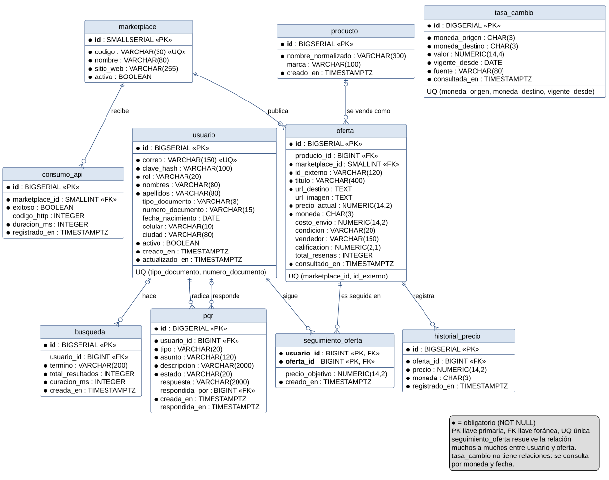

# Modelo entidad relación



El diagrama corresponde a las migraciones V1 a V4 de `base-de-datos/migraciones`. La fuente es
[`mer-marketradar.puml`](mer-marketradar.puml) (PlantUML); la imagen está en SVG y en PNG.

## Entidades

| Entidad | Qué representa |
| --- | --- |
| `marketplace` | Tienda en línea que consulta Marketradar (AliExpress, Shopify, Mercado Libre). |
| `producto` | Producto normalizado que agrupa las ofertas del mismo artículo en distintas tiendas. |
| `oferta` | Publicación concreta de un producto en una tienda, con su precio actual, envío y reseñas. |
| `historial_precio` | Cada precio que tuvo una oferta a lo largo del tiempo. |
| `consumo_api` | Cada llamada a la API de una tienda, para medir su disponibilidad. |
| `usuario` | Persona registrada, con rol USUARIO o ADMINISTRADOR. |
| `busqueda` | Cada búsqueda hecha en la aplicación, con o sin usuario. |
| `pqr` | Petición, queja, reclamo o sugerencia de un usuario y la respuesta del administrador. |
| `tasa_cambio` | Valor de una moneda en pesos colombianos a partir de una fecha. |

## Relaciones y cardinalidades

| Relación | Cardinalidad | Llave foránea | Regla de borrado |
| --- | --- | --- | --- |
| Una tienda publica ofertas | `marketplace` 1 a 0..N `oferta` | `oferta.marketplace_id` (NOT NULL) | Restringido |
| Un producto se vende como ofertas | `producto` 0..1 a 0..N `oferta` | `oferta.producto_id` (admite nulo) | Restringido |
| Una oferta registra su historial | `oferta` 1 a 0..N `historial_precio` | `historial_precio.oferta_id` | En cascada |
| Una tienda recibe consultas a su API | `marketplace` 1 a 0..N `consumo_api` | `consumo_api.marketplace_id` | Restringido |
| Un usuario hace búsquedas | `usuario` 0..1 a 0..N `busqueda` | `busqueda.usuario_id` (admite nulo) | Queda en nulo |
| Un usuario radica PQR | `usuario` 1 a 0..N `pqr` | `pqr.usuario_id` (NOT NULL) | Restringido |
| Un administrador responde PQR | `usuario` 0..1 a 0..N `pqr` | `pqr.respondida_por` (admite nulo) | Restringido |

"Restringido" significa que PostgreSQL no deja borrar la fila padre mientras tenga filas hijas (comportamiento por
defecto de `REFERENCES`). `producto_id` admite nulo porque una oferta se guarda apenas llega de la tienda, antes de
asociarla a un producto normalizado. `tasa_cambio` no se relaciona con otras tablas: se consulta por moneda y fecha.

Las vistas de V4 (`vista_ofertas_vigentes`, `vista_bajadas_precio`, `vista_resumen_pqr` y
`vista_disponibilidad_api`) no aparecen como entidades porque no guardan datos: se calculan a partir de estas tablas.

## Cómo regenerar la imagen

Con PlantUML 1.2024 o más reciente (no necesita Graphviz gracias a `!pragma layout smetana`):

```bash
java -jar plantuml.jar -tsvg mer-marketradar.puml
java -jar plantuml.jar -tpng mer-marketradar.puml
```

También se puede pegar el contenido del `.puml` en <https://www.plantuml.com/plantuml> para ver y descargar la imagen.
